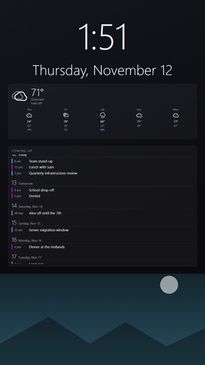
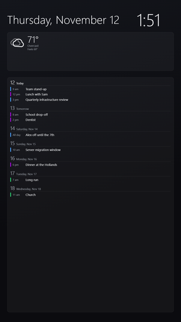
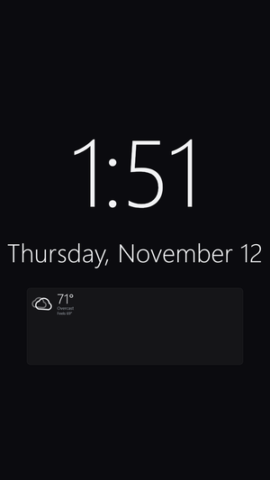
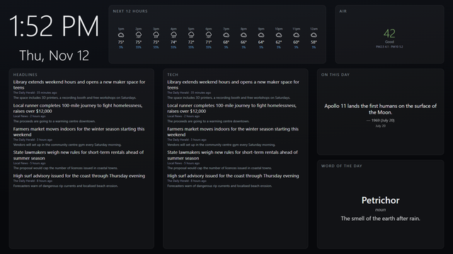
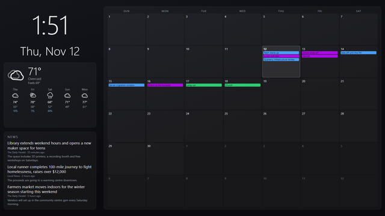
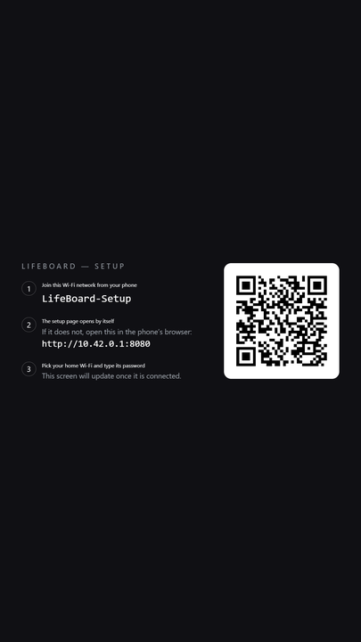
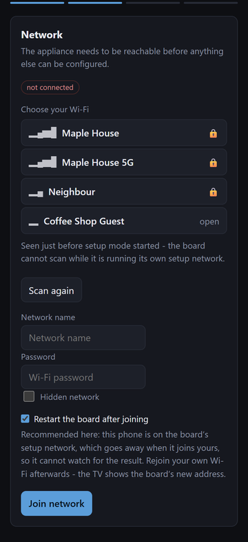
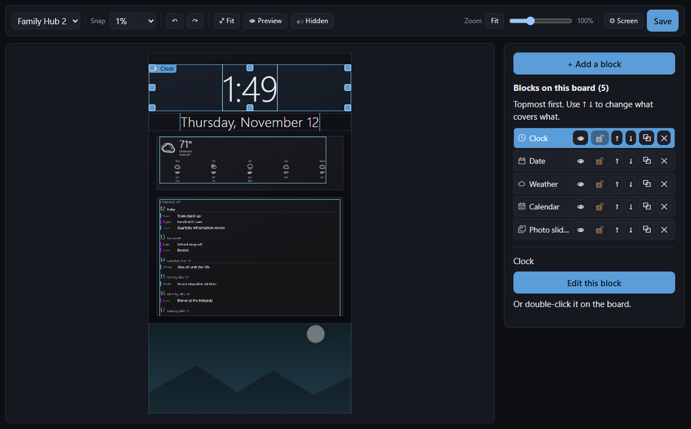

# LifeBoard

A self-hosted wall dashboard for a TV or monitor: calendars, weather, photos,
live video, Home Assistant, news and to-do lists on one screen. It runs on
hardware you own, with no subscription and no cloud account, as a replacement
for services like DAKboard.

Flash the image to a Raspberry Pi or an x86 mini PC, plug it into a screen,
and set everything up from your phone or laptop. There is also an Android TV
app that runs the whole board on a TV box.

<p align="center">
  
  &nbsp;
  
  &nbsp;
  
</p>
<p align="center">
  
  &nbsp;
  
</p>

<sub>Built-in templates, shown with the editor's sample data.</sub>

---

## What it does

| | |
|---|---|
| **Calendars** | Google, Microsoft 365 and iCal/.ics, merged into one stream with per-calendar colours. Agenda, mini-month, full month, week, timeline and bubbles styles. A day with more appointments than fit scrolls through them. |
| **Weather** | Current conditions, hourly and daily forecasts, air quality, sun and moon, alerts. Open-Meteo, **no API key needed**. |
| **Photos & clips** | Slideshow across several albums at once with crossfade and a shuffle that shows everything before repeating. Videos mix in with the stills. Local folder, Immich, or a Google Photos share link ([read this first](docs/google-photos.md)). |
| **Video** | YouTube (including "whatever this channel is streaming now"), Vimeo, direct files, HLS. Audio on or off per block. Hardware-decoded through mpv, so a permanent live stream works on a Pi. |
| **Home Assistant** | Any entity as a tile, people with zone and battery, interactive controls (lights, switches, scenes, thermostats), history sparklines, camera stills, now-playing. The HA token never reaches the wall page. |
| **Lists** | Google Tasks, Microsoft To Do, Planner as a Kanban board, SharePoint lists, sticky notes. Tick things off on a touch screen. |
| **Daily content** | Quote, Bible verse, word of the day, joke, advice, on this day. Free sources, no keys. |
| **Local facts** | Tides (NOAA) and FAA airport delays, both keyless. RSS headlines or a ticker. |
| **Anything with an HTTP endpoint** | Generic REST/JSON source with value, gauge and chart blocks. Webhooks push values in. |
| **Also** | Clock, date, countdown, text, images, shapes, QR codes (including Wi-Fi join codes), web page embeds, sandboxed custom HTML. |
| **Backgrounds** | A full-bleed photo or album behind the board, dimmable and blurrable. Blocks can be solid, frosted glass, lit glass, outline or transparent. |
| **Display power** | Scheduled on and off through HDMI-CEC or DPMS, including overnight windows. |
| **Orientation** | Portrait or landscape, rotated at the display server so video keeps hardware decode. |
| **Templates** | 29 built-in layouts, 16 portrait and 13 landscape. |

## Setting up a new board

No keyboard, no config files. Flash the image, power it on, and:

<table>
<tr>
<td width="50%" valign="top">

</td>
<td width="50%" valign="top">

</td>
</tr>
</table>

1. **If there is no network after about 45 seconds,** the board starts an open
   Wi-Fi network called **`LifeBoard-Setup`** and the TV shows how to join it,
   with a QR code.
2. **Join it from your phone.** The setup page opens by itself, the same way
   hotel Wi-Fi does. If it does not, open `http://10.42.0.1:8080`.
3. **Create the admin account, then tap your Wi-Fi network** in the list and
   type its password. The list comes from a scan taken just before setup mode
   started, because the Wi-Fi chip cannot scan while it is running its own
   network.
4. **The board joins your Wi-Fi** and the TV shows its new address. If the
   password was wrong, the setup network comes back and the TV and the setup
   page both say what went wrong.
5. Pick a template, add your calendars and photos, and it becomes your board.

This runs on every boot, so a board that moves house or whose Wi-Fi password
changes can be fixed the same way. Ethernet works with no setup at all.

You can still put a `lifeboard-wifi.txt` on the boot partition instead, with
`ssid=` and `password=` lines; it is read once and deleted.

## The layout editor



Drag blocks around a live preview drawn by the same code and stylesheet the
wall uses, so what you line up in the editor is where it lands on the screen.
Blocks without a source yet are drawn with sample data.

- **Two outlines per block.** The faint dashed box is the area the block owns;
  the solid outline is what it actually draws. Line things up by what you can
  see, not by invisible boxes.
- **Fit to content** (the Fit button, or `F`) shrinks the selected blocks to
  what they draw, keeping any panel's padding.
- **Alignment guides** snap a block's edges and centre to other blocks' content
  and to the middle of the board. Hold `Alt` to drag freely.
- **Pixel-exact.** Snap to `1 px`, nudge one board pixel with the arrow keys
  (`Shift` for 5%), and the readout shows position and size in board pixels.
- Undo and redo, multi-select with `Shift`, zoom, layers, per-block fonts,
  colours, panels and schedules, revision history, import and export.

Layouts are stored in percent of the screen, so a board laid out for a 1080p
panel looks the same on 4K or after a rotation.

## Hardware

- **Raspberry Pi 3B or newer**, arm64. A Pi 4 or 5 is better for live video.
  HDMI-CEC is built in, so scheduled power really turns the TV off.
- **x86-64 mini PC** (an N100 box is plenty), UEFI or legacy BIOS.
- **Android TV box**, Android 7.0 or newer. See [android/README.md](android/README.md).

### Live video on a Pi

Chromium on a Pi has no hardware decode for YouTube's VP9/AV1, so the page
does not play video itself. **yt-dlp** resolves the link to an H.264 stream and
**mpv** plays it with hardware decode in a borderless window placed exactly
over the block. The stream address is refreshed every two hours, so a live
stream that runs all day keeps working.

## Install

### Flash an image

Build on any Linux host with root (a privileged Debian container works):

```bash
sudo ./image/build-pi-image.sh  lifeboard-pi.img   # Raspberry Pi, arm64
sudo ./image/build-x86-image.sh lifeboard.img      # x86-64
```

Write it with Raspberry Pi Imager, balenaEtcher, Rufus or `dd`. The root
partition grows to fill the card or disk on first boot.

Optional build-time settings:

| Variable | Default | Effect |
|---|---|---|
| `LIFEBOARD_HOSTNAME` | `LifeBoard` | Hostname; a Pi image also answers to `LifeBoard.local` |
| `LIFEBOARD_WIFI_COUNTRY` | `US` | Wi-Fi regulatory country |
| `LIFEBOARD_SSH_KEY` | none | Public key for root over SSH |
| `LIFEBOARD_ROOT_PASSWORD` | none | Root password for the local console |
| `LIFEBOARD_LOCK_CONSOLE` | `0` | `1` disables every local console login |
| `LIFEBOARD_CLEAN_IMAGE` | `0` | `1` ignores any key or password, for an image to hand out |

Images contain no keys or passwords unless you pass them, and each board
generates its own SSH host keys on first boot.

### Or install on an existing Debian machine

```bash
git clone https://github.com/geoguy89/lifeboard.git && cd lifeboard
sudo ./image/install.sh
```

## How it fits together

```
        ┌──────────────── the device ─────────────────┐
        │                                              │
  TV ◄──┤  Chromium (kiosk) ──► /render/   (no login)  │
        │                          │                   │
        │                          ▼                   │
        │                    FastAPI :8080 ──► SQLite  │
        │                          ├─► calendars, weather, RSS, photos
        │                          ├─► Home Assistant
        │                          ├─► mpv + yt-dlp (video)
        │                          └─► CEC / DPMS (screen power)
        └──────────────────────────┼───────────────────┘
                                   ▼
                     /admin/  (password, from your phone or laptop)
```

The wall page needs no login because the TV boots before anyone could type
one; it is read-only. Every external request is made by the server, so
credentials never reach the page the TV shows.

## Repository

```
server/lifeboard/     FastAPI app: routes, SQLite, data providers,
                      display power, native video, Wi-Fi and setup hotspot
web/render/           what the TV loads (board.css is shared with the editor)
web/admin/            the admin UI and layout editor
templates/            the built-in layouts (JSON)
deploy/               systemd units, kiosk and first-boot scripts,
                      NetworkManager hooks for the setup hotspot
image/                install.sh and the Pi and x86 image builders
android/              the Android TV app
tools/                tests and helper scripts
docs/                 Google Photos and OAuth notes
```

## Tests

```bash
python tools/smoke_test.py          # end to end against a throwaway database
python tools/test_wifi_setup.py     # setup hotspot, network list, captive portal
python tools/test_no_secrets.py     # nothing personal in anything that ships
python tools/check_widgets.py       # widget, catalogue and template consistency
node tools/test_editor.mjs          # the layout editor, including drag gestures
node tools/test_preview.mjs         # every widget renders in the editor preview
node tools/test_admin_boot.mjs      # the admin and the renderer boot cleanly
node tools/test_calendar_styles.mjs # every calendar style, across timezones
sh tools/tree-hash.sh               # one hash for the deployed code tree
```

The Python tests need the packages in `server/requirements.txt`.

## Notes

- **Google calendars** can use the private iCal address with no setup. OAuth
  is supported too; Google only accepts HTTPS or loopback redirect addresses,
  so see [docs/oauth.md](docs/oauth.md). Microsoft uses device-code sign-in
  and needs none of that.
- **Google Photos** withdrew unattended album access in 2025. Read
  [docs/google-photos.md](docs/google-photos.md) before choosing a photo
  source.

## License

[MIT](LICENSE). Third-party services keep their own terms.
